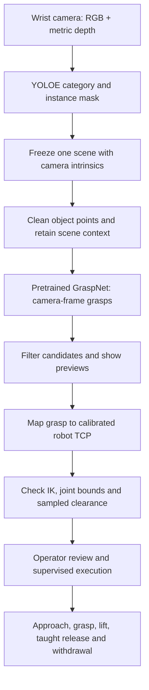
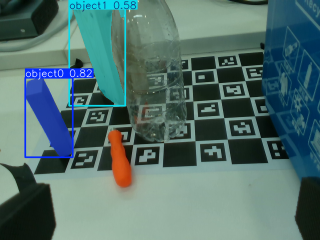

# Piper YOLO + GraspNet Robotic Picking

[简体中文](README.zh-CN.md) · [Credits](CREDITS.md) · [Evidence and limitations](docs/evaluation.md)

A robotics integration project maintained by **Joel Tang**: connect YOLOE object selection and RGB-D geometry to pretrained GraspNet proposals, then plan supervised tabletop transfers with an AgileX Piper arm.

**Based on [piper-vision-grasp-new by xsb2lyang](https://github.com/xsb2lyang/piper-vision-grasp-new).** The original application supplied calibration, monitoring, teleoperation, keypoint capture, and click-to-pick workflows. This adaptation extends that foundation using upstream pretrained models. No new YOLOE or GraspNet model training is claimed.

**Status: supervised bench prototype.** Development notes report two successful wooden-block transfers, without a controlled success-rate benchmark. The latest planning changes have only offline verification documented. See [evaluation](docs/evaluation.md) before interpreting a preview as a validated physical grasp.

## What this adaptation adds

| Area | Work added or adapted here |
| --- | --- |
| Perception | YOLOE/YOLO-World integration, category prompting and selection, and mask handling. |
| RGB-D geometry | Captured-frame intrinsics, frozen scene data, foreground isolation, and rejection of insufficient depth. |
| Grasp proposals | A separate GraspNet inference worker, saved-scene replay, candidate filtering, and interactive previews. |
| Robot integration | Camera/gripper/TCP mapping, bounded inverse kinematics, sampled route checks, and supervised execution to a taught release pose. |
| Hardware setup | Local D435i selection, camera/hand-eye/TCP calibration, taught poses, and gripper geometry configuration. |
| Verification | Regression checks for frames, depth contamination, planning, capture freshness, execution ordering, and failures. |

See [CREDITS.md](CREDITS.md) for inherited components and contribution boundaries.

## From camera image to robot action



The preview-only launcher stops at visualization. Grasp scores rank proposals; they are not measured pickup-success probabilities. Simplified scene checks do not establish complete arm collision clearance.

## Saved perception example



**Offline visual-prompt experiment:** two boxes were supplied manually on this same image. YOLOE returned block masks at scores of approximately 0.82 and 0.58. This illustrates prompted segmentation, not autonomous recognition across views or a successful robot grasp. Labels are generic visual-prompt IDs.

[Input image, prompt boxes, raw results, and interpretation](docs/evaluation.md#saved-block-perception-experiment) are included. This separate experiment does not imply that the category GUI implements manual box prompting. A physical pick-and-place video has not yet been added.

## Hardware and software

- AgileX Piper arm and parallel-jaw gripper.
- Wrist-mounted RealSense D435i in the local setup; the adapter also supports D405/D435-family devices.
- Ubuntu 22.04 target environment, Python 3.10, and a repo-local application virtual environment.
- Ultralytics YOLOE/YOLO-World with externally obtained pretrained weights.
- A separate compatible GraspNet runtime with PyTorch/CUDA and compiled point-cloud operators.

Saved calibration and poses describe one physical setup. Revalidate mounting, frames, tool geometry, and workspace assumptions when moving to another setup.

## Getting started

Install Git and [uv](https://docs.astral.sh/uv/getting-started/installation/), then:

```bash
git clone https://github.com/joeltang17/piper-yolo-grasp-project.git
cd piper-yolo-grasp-project
./scripts/setup_env.sh
./scripts/run_doctor.sh
```

The setup script installs the application environment. **It does not recreate the separate GraspNet CUDA environment or download all models.** The current GraspNet YAML references a sibling legacy checkout; update those paths on a new computer. See [reproduction and migration](docs/reproduction.md).

| Entry point | Purpose | Motion capability |
| --- | --- | --- |
| `./scripts/run_graspnet_target_pick_demo.sh` | Category-driven GraspNet preview and replay | Preview only; motion refused |
| `./scripts/run_graspnet_pick_demo.sh` | Supervised GraspNet pick trial | Can command the arm; starts with dry-run checked |
| `./scripts/run_yolo_target_pick_demo.sh` | Legacy category-driven box-centre pickup | Can command the arm when live |
| `./scripts/run_click_pick_demo.sh` | Legacy manual pixel selection | Can command the arm when live |
| `./scripts/run_monitor.sh` | Robot/camera observation | Monitoring only |

Follow the physical jaw-alignment workflow in the [supervised trial guide](docs/graspnet_pick_demo.md) before execution. A visible candidate alone is not a complete execution plan.

## Documentation

- [Reproduction and laptop migration](docs/reproduction.md)
- [Evidence, evaluation protocol, and limitations](docs/evaluation.md)
- [GraspNet target preview](docs/graspnet_target_pick_demo.md)
- [Supervised GraspNet pick trial](docs/graspnet_pick_demo.md)
- [Candidate and complete-plan rejections](docs/graspnet_plan_rejections.md)
- [Calibration, teleoperation, and inherited workflows](docs/README.md)
- [Provenance and acknowledgements](CREDITS.md)

The distribution name `piper-vision-grasp-new` and Python package `piper_app` remain for compatibility. Historical commits and inherited guides retain their original authorship and terminology.

## Credits and licensing

Built on [xsb2lyang's workspace](https://github.com/xsb2lyang/piper-vision-grasp-new), [AgileX pyAgxArm](https://github.com/agilexrobotics/pyAgxArm), [Ultralytics](https://github.com/ultralytics/ultralytics), [GraspNet baseline](https://github.com/graspnet/graspnet-baseline), and [RealSense SDK](https://github.com/realsenseai/librealsense).

The existing [LICENSE](LICENSE) and [third-party notices](THIRD_PARTY_NOTICES.md) are retained. The root statement does not relicense dependencies or weights. GraspNet baseline has a separate noncommercial research-use agreement, and Ultralytics has its own terms. See [runtime/model notices](THIRD_PARTY_NOTICES.md#runtime-and-model-dependencies).
