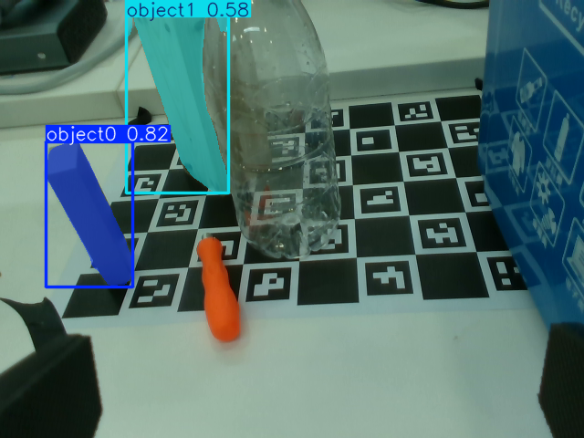

# Piper YOLO + GraspNet 机器人抓取

[English](README.md) · [项目来源与致谢](CREDITS.md) · [实验记录](docs/evaluation.md)

由 **Joel Tang** 维护的机器人系统集成项目：利用 YOLOE 选择目标，将 RGB-D 数据转换为点云，通过预训练 GraspNet 生成抓取候选，再使用 AgileX Piper 机械臂完成受监督的桌面搬运实验。

本项目基于 [xsb2lyang/piper-vision-grasp-new](https://github.com/xsb2lyang/piper-vision-grasp-new)。原项目提供标定、监控、遥操作、关键位记录和点击抓取流程；本分支扩展感知、GraspNet 接入、规划与执行。这里不声称自行训练或提出 YOLOE、GraspNet 模型。

## 本分支的主要工作

- YOLOE / YOLO-World 接入、类别选择与目标掩码处理。
- 固定帧 RGB-D、相机内参、前景点云提取和深度不足拒绝。
- 独立 GraspNet 推理进程、抓取预览、候选过滤与离线回放。
- 相机与机器人 TCP 映射、受限逆运动学、采样路径检查和受监督执行。
- D435i 本地适配、相机/手眼/TCP 标定、示教位姿及回归检查。

继承功能与新增工作的边界见 [CREDITS.md](CREDITS.md)。

## 当前状态

这是受监督的台架原型。开发文档记录了两次用户报告的木块搬运成功，但没有受控的成功率统计；最新规划改动的现有记录仅包括离线验证。抓取分数不是实际成功概率，简化碰撞模型不能保证完整机械臂路径无碰撞。



上图是独立的离线视觉提示实验，不代表跨视角自动识别或机器人抓取成功，也不代表当前类别 GUI 实现了手动框提示。原始结果见 [实验记录](docs/evaluation.md)。目前尚未加入实物抓取视频。

## 开始使用

目标环境为 Ubuntu 22.04、Python 3.10 和 uv。安装 Git 与 uv 后：

```bash
git clone https://github.com/joeltang17/piper-yolo-grasp-project.git
cd piper-yolo-grasp-project
./scripts/setup_env.sh
./scripts/run_doctor.sh
```

应用安装脚本不会重建独立的 GraspNet CUDA 环境或下载所有模型。当前 GraspNet 配置引用旧项目的相对路径；迁移需要重新配置。见 [复现与迁移](docs/reproduction.md)。

- [英文介绍与流程图](README.md)
- [GraspNet 预览](docs/graspnet_target_pick_demo.md)：拒绝运动命令。
- [受监督抓取](docs/graspnet_pick_demo.md)：可以控制机械臂，默认勾选 dry-run。
- [候选与路径拒绝原因](docs/graspnet_plan_rejections.md)
- [原有中文文档](docs/README.zh-CN.md)

原有许可、版权声明和提交历史保留。依赖和模型受其自身条款约束；GraspNet baseline 包含独立的非商业研究使用协议，见 [第三方声明](THIRD_PARTY_NOTICES.md)。
