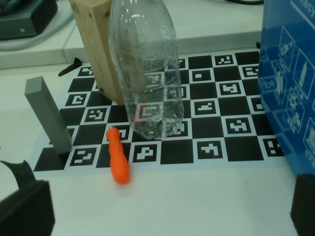
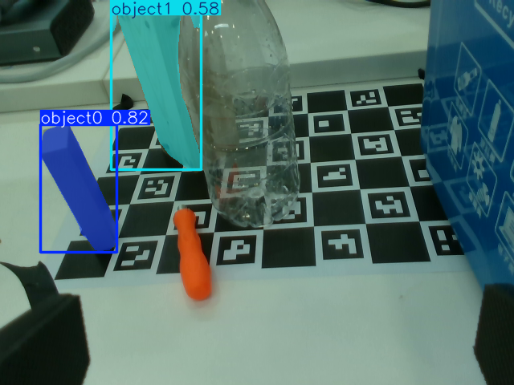

# Evidence, evaluation, and limitations

Saved perception, software checks, and physical trials answer different questions. None of the evidence below establishes general-purpose robotic picking.

## Current evidence

| Evidence | Supported observation | Scope |
| --- | --- | --- |
| Saved block image and JSON | YOLOE returned masks for two manually boxed blocks. | One saved view, offline; no robot motion. |
| Regression tests and replay notes | Software checks exercise geometry, frames, planning, and execution. | Historical counts vary; rerun and record a commit for new claims. |
| Two wooden-block transfers in development notes | The integration has reported physical trial experience. | User-reported; no controlled denominator or reviewed video supplied here. |
| Latest planning/responsiveness changes | Existing records describe offline checks. | Physical revalidation of that revision is not claimed. |

Physical reports and prior replay descriptions are in the [supervised trial guide](graspnet_pick_demo.md). A real pick-and-place video is not yet included.

## Saved block perception experiment





- Model: pretrained `yoloe-26s-seg.pt`; no fine-tuning in this experiment.
- Input: one saved 640 x 480 wrist-camera RGB frame.
- Manual boxes in `[x1, y1, x2, y2]` pixels:
  - Gray block (`object0`): `[52, 151, 151, 316]`.
  - Wooden block (`object1`): `[143, 0, 252, 215]`.
- Display threshold: 0.25.

| Supplied visual example | Returned label | Score |
| --- | --- | --- |
| Gray block | `object0` | 0.81774 |
| Wooden block | `object1` | 0.58032 |

The [original JSON](evidence/yoloe-block-comparison.json) includes lower-threshold diagnostic outputs. The displayed image filters scores below 0.25. In the text-prompt diagnostic the bottle scored 0.87852, while block-related responses were below 0.04 and included incorrect labels/locations. This observation applies only to that scene and prompt setup.

Boxes were supplied on the same image being segmented. This demonstrates prompted mask extraction, not learned object memory, cross-view recognition, valid depth, or physical grasp success. This separate experiment does not imply a manual box-prompt mode exists in the category GUI. Scores are model outputs, not grasp-success probabilities.

Timings in the preserved JSON lack a complete hardware/software benchmark record. They are not a model-speed comparison.

### Repeat the perception check

With compatible Ultralytics, the checkpoint, and encoder available, run from the repository root:

```python
import numpy as np
from ultralytics import YOLOE

model = YOLOE("models/yoloe-26s-seg.pt")
result = model.predict(
    source="docs/media/block-scene.png",
    visual_prompts={
        "bboxes": np.array([[52, 151, 151, 316], [143, 0, 252, 215]], dtype=np.float32),
        "cls": np.array([0, 1]),
    },
    device="cpu", imgsz=640, conf=0.25, iou=0.45, max_det=20,
)
```

Results may vary by runtime version; the JSON preserves the original record. See the [YOLOE API documentation](https://docs.ultralytics.com/models/yoloe/).

## Physical evaluation to add

Before reporting a success rate:

1. Record code commit, model hashes, environment, object dimensions/material, camera pose, lighting, and gripper settings.
2. Fix the object placements and trial count in advance; retain failed trials and refusals.
3. Record selection, plan acceptance, lift, transport, and release into the bin separately.
4. Define complete success as an object actually lifted, retained during transport, and released into the intended bin. Settled joint feedback alone is insufficient.
5. Report total attempts, planning refusals, motion attempts, and complete successes, with an explicit denominator for each rate.
6. Keep an original recording; disclose edits, retries, and playback speed in a portfolio clip.

The trial guide's eight-out-of-ten target is an acceptance target, not a measured result.

## Known limitations

- Transparent/reflective, small, and occluded objects can have missing or background depth.
- Prompt/category selection does not guarantee recognition or a usable mask.
- A plausible grasp can fail IK, joint limits, transfer, release, or withdrawal checks.
- Sampled scene checks use simplified hand/camera geometry. Full-arm geometry, unseen obstacles, and complete physical gripper geometry are unverified.
- The supervised workflow assumes a static scene and correct calibration.
- External GraspNet code/runtime and model assets are needed beyond a fresh clone.

## Recording the demonstration

Show the hardware, selected object/mask, candidate preview, supervised approach, and actual transfer. State the tested revision and task boundaries. Include an explanatory failed/rejected example when illustrating a limitation.

Until a recording exists, the README uses this project's saved perception evidence rather than an upstream or generated robot demonstration.
